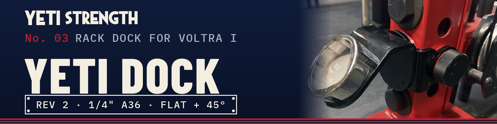

<a href="README.md"><b>← YETI DOCK</b></a> · <a href="https://github.com/Schnibbz"><b>YETI STRENGTH home</b></a>

# YETI DOCK — drilling, tapping and assembly

## 1. Drill out the tapped holes, then tap

The shop cuts every tapped hole **undersize on purpose**. A laser leaves a thin, hardened skin on the wall of every hole. Tap
straight into that and the tap grinds, binds and breaks. Drilling the hole out one size first cuts the skin away, and the tap
then runs like it's in mild steel.

| Part | Holes | As cut | Drill to | Tap |
|---|---|---|---|---|
| Base bracket | 8 (4 in the face, 2 in each side) | Ø3.3 mm | **#21** (0.159" / 4.04 mm) | **#10-24** |
| 45° adapter (add-on) | 8 in the top plate | Ø3.2 mm | **3.5 mm** | **M4 × 0.7** |

Tested: #21 then a 10-24 tap goes through ¼" A36 cleanly.

**How to tap ¼" steel:**
- Spiral-point (gun) tap, not a hand taper tap. It pushes the chips ahead and out the far side.
- Drill or tapping head at 200–400 rpm, clutch set low, so a jam slips the clutch instead of snapping the tap.
- Cutting oil on every hole (sulfur-based is best).
- Cobalt drill bits.
- Keep the tap square. A guide block or a drill press beats freehand.
- Blow the chips out and wipe the oil off before you fit the pads.

## 2. What drilling out does to the thread, and why it's fine

"Percent thread" is how much of a full-depth thread the tapped hole has. The standard tap drill gives about 75%. Drilling a
bigger hole first leaves less material for the tap to cut, so the thread is shallower.

| Screw | Hole before tapping | Thread |
|---|---|---|
| #10-24 | 3.80 mm / #25 (the standard tap drill) | **75 %** |
| #10-24 | #22 (0.157") | 61 % |
| #10-24 | **#21 (0.159") — what you use** | **57 %** |
| M4 × 0.7 | 3.3 mm (the standard tap drill) | **77 %** |
| M4 × 0.7 | **3.5 mm — what you use** | **55 %** |

**Why the thread doesn't need 75 %.** A screw thread almost never fails across its full depth. The load is carried by the
shear area along the root of the threads, and above about 50 % thread the screw itself breaks before the threads strip, as
long as the engagement is long enough. Here it is:

- ¼" plate = **6 full threads** for a 10-24 (1.3 × the screw's diameter) and **9 threads** for an M4 (1.6 × diameter).
- Going from 75 % to 57 % cuts the tapping torque roughly in half. That's why the tap stops breaking.

**The numbers** (conservative hand estimates: A36 steel, thread shear area scaled straight down with percent thread, which
overstates the loss):

| Joint | Load in use | Strips at 75 % (std) | Strips at what you drill | Margin |
|---|---|---|---|---|
| #10-24 pad screws (8) | ~25 lb each, holding the pads against the rack | ~3,100 lb | **~2,400 lb** (57 %) | **~95×** |
| M4 adapter screws (8) | ~55 lb on the worst screw at the VOLTRA's 200 lb max, 45° adapter | ~2,650 lb | **~1,900 lb** (55 %) | **~34×** |

For scale, the screws themselves break at about 2,975 lb (10-24 alloy socket cap) and 2,400 lb (M4 class 12.9). The shallower
thread costs roughly a quarter of the stripping strength on paper, and in practice less. Either way the joint is still
dozens of times stronger than anything the dock can put on it.

How the M4 load was estimated: 200 lb at the dock, about 2" out from the bracket face, makes ~410 in-lb trying to peel the
adapter off. Spread over the 8-screw pattern, pivoting about the plate edge, the worst screw sees ~36 lb, plus ~18 lb from the
straight pull-away. ~55 lb.

**Not load-tested.** These are calculations, not a pull test. Inspect the screws and the pin before every session.

## 3. Print the pads

PETG, **counterbore side up**, 0.2 mm layers, 6 walls, 40 % infill, no supports.

- `pads/yeti-dock-pad-set.stl`: one centre pad (7.75 mm) + two side pads (6.60 mm). About 2 hours, 65 g.
- The centre pad sets the preload. If the pin won't slide through with 7.75, print `yeti-dock-web-pad-7.10.stl`.

## 4. Hardware

**Base bracket**

| Qty | Part |
|---|---|
| 8 | #10-24 × 3/8" button-head socket cap screws (4 centre pad, 2 per side pad) |
| 4–8 | M4 screws for the dock, per Beyond Power's DIY Dock instructions |
| 1 | 1" pin (Oak Club Magpin, Ø25.0 mm) |

**45° adapter, add**

| Qty | Part |
|---|---|
| 8 | M4 socket cap screws, adapter to bracket |

3/8" is the longest #10-24 that won't poke through the far side of the steel with these pads. Check yours finish flush or short
before the dock goes on.

## 5. Put it together

**Base bracket (flat dock)**
1. Drill and tap the bracket's 8 holes (step 1). Clean out the chips and oil.
2. Screw the two side pads and the centre pad in, counterbores facing the rack. Snug, don't crush the PETG.
3. Bolt the dock to the bracket face. The 8-hole pattern lets you clock it 0° or 90°.
4. Slide the bracket over the upright, line it up with the hole, and push the pin all the way through. It should slide in by
   hand and the bracket shouldn't rock. If it rocks, the centre pad is too thin; if the pin won't go, it's too thick.

**With the 45° adapter**
1. Drill and tap the bracket's 8 holes and the adapter's 8 holes (step 1).
2. Fit the pads as above.
3. Bolt the adapter to the outside face of the bracket with the 8 M4 screws, from inside the bracket. The heads sit in the
   centre pad's clearance holes, so do this before the bracket goes on the rack.
4. Bolt the dock to the adapter's angled face (0° or 90°).
5. Hang it on the upright and pin it, as above.

 

