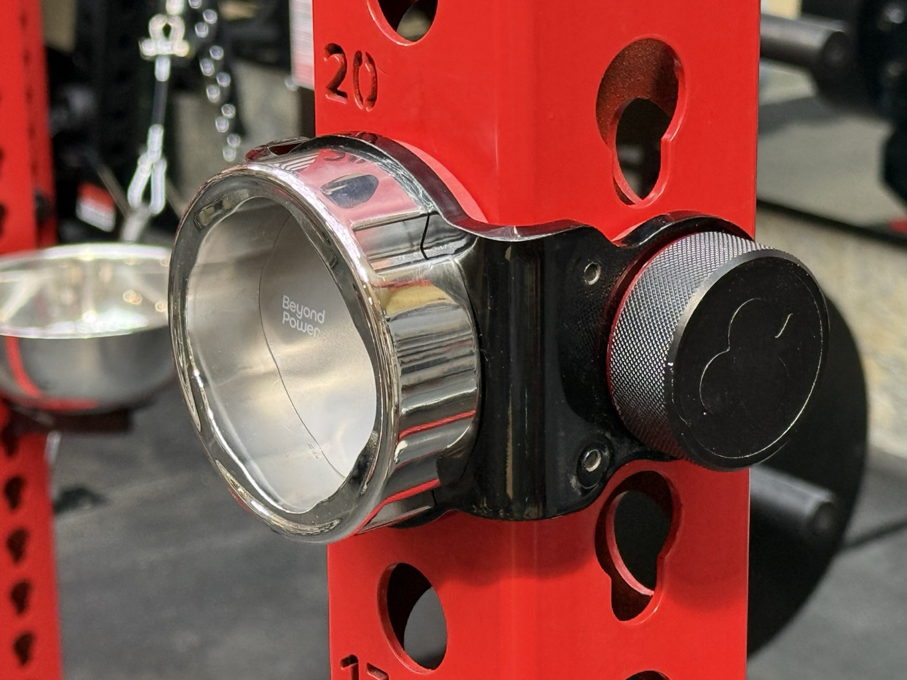
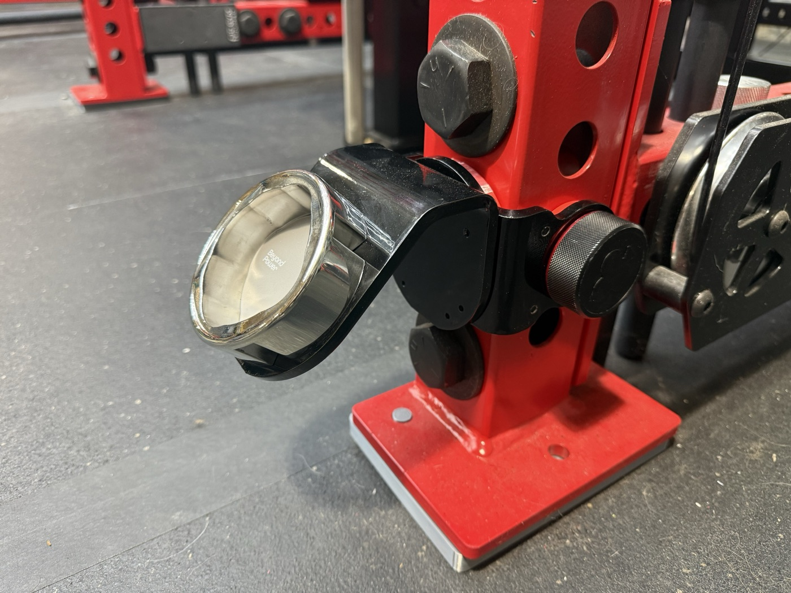

<a href="https://github.com/Schnibbz"><b>← YETI STRENGTH home</b></a> · all gear by <a href="https://github.com/Schnibbz">Schnibbz</a>

A laser-cut steel bracket that hangs a **VOLTRA I DIY Dock** on a 3×3 rack upright. It clips around the upright, a 1" pin goes
through the bracket and the upright's hole, and the dock bolts to its face.

**Two parts, pick what you need:**

| | Part | You need it for |
|---|---|---|
| **1** | **Base bracket** | Every build. The dock bolts flat to its face. |
| **2** | **45° adapter** (add-on) | Angling the dock out from the rack. Bolts onto the base bracket; it can't be used on its own. |

---

## 1. Base bracket

- **Fits** 3×3 uprights with 1" holes. Built and fitted on a Rogue Monster 11 ga upright (holes measured Ø26.7 mm).
- **Pin:** one 1" pin. Built around the Oak Club Magpin (Ø25.0 mm). A Fringe Sport pin (Ø24.5) fits but leaves 0.5 mm more slop.
- **Steel:** ¼" A36, two 90° bends.
- **PETG pads** line the inside so steel never touches the rack. The centre pad is thick enough to preload the bracket off the
  upright, so the pin bears on one side and the dock doesn't clunk between reps.

| File | What |
|---|---|
| [`bracket/yeti-dock-bracket-rev2-0.250-A36.dxf`](bracket) | **Order this.** Flat pattern for a laser + bend shop |
| [`bracket/yeti-dock-bracket-rev2.step`](bracket) | 3D reference |
| [`pads/yeti-dock-pad-set.stl`](pads) | The PETG pads: centre pad 7.75 mm + 2 side pads (also single pads and a 7.10 mm centre pad) |

| Qty | Hardware |
|---|---|
| 8 | #10-24 × 3/8" button-head socket cap screws (pads) |
| 4–8 | M4 screws for the dock, per Beyond Power's DIY Dock instructions |
| 1 | 1" pin (Oak Club Magpin) |

## 2. 45° adapter (add-on)

Bolts to the face of the base bracket with 8 M4 screws from inside the bracket. The dock then bolts to the adapter's angled face.
¼" A36, one 45° bend.

| File | What |
|---|---|
| [`adapter-45/yeti-dock-adapter45-v7-0.250-A36.dxf`](adapter-45) | **Order this too** if you want the angle |
| [`adapter-45/yeti-dock-adapter45-v7.step`](adapter-45) | 3D reference |

| Qty | Extra hardware |
|---|---|
| 8 | M4 socket cap screws, adapter to bracket |

---

## Order the steel

Upload the DXF(s) to a laser-cut-and-bend shop (it was made at OSH Cut). ¼" (6.35 mm) A36 or HRPO, inside bend radius 4.0 mm.
Don't pay for the shop's tapping: you drill and tap the holes yourself.

## Build it

**[ASSEMBLY.md](ASSEMBLY.md)** has every step and the engineering behind it:

- **Drill out, then tap.** The tapped holes come undersize on purpose. Base bracket: drill 8 to **#21**, tap **#10-24**.
  45° adapter: drill 8 to **3.5 mm**, tap **M4**. That cuts off the laser's hardened skin so the tap doesn't break.
- **Why the shallower thread is fine.** #21 gives 57 % thread instead of 75 %, and 3.5 mm gives 55 % instead of 77 %. The
  joints are still about **95×** (pad screws) and **34×** (adapter screws) stronger than the dock can load them.
- Pad printing, and assembly in order for each build.

## Load

The VOLTRA I pulls up to 200 lb. A hand calculation at 200 lb with the 45° adapter puts about 12 ksi in the bracket at the bend,
against 36 ksi yield for A36. **It has not been load-tested.** Check the pin is fully home and the screws are tight before every
session.

## License

[CC BY-NC-SA 4.0](https://creativecommons.org/licenses/by-nc-sa/4.0/): make it for yourself, share it and remix it with credit.
**Not for commercial use**, and remixes keep the same license.

VOLTRA and Beyond Power are trademarks of Beyond Power. This is an independent design, not made or endorsed by them.

 

